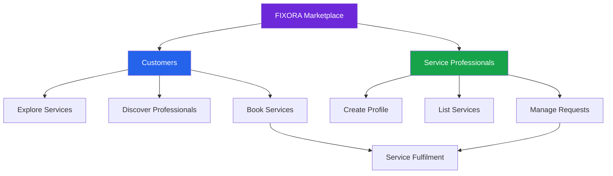
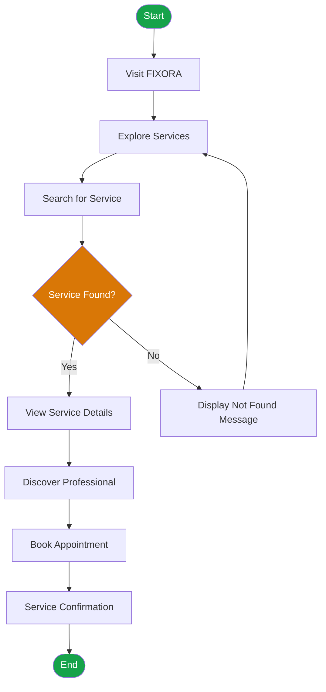
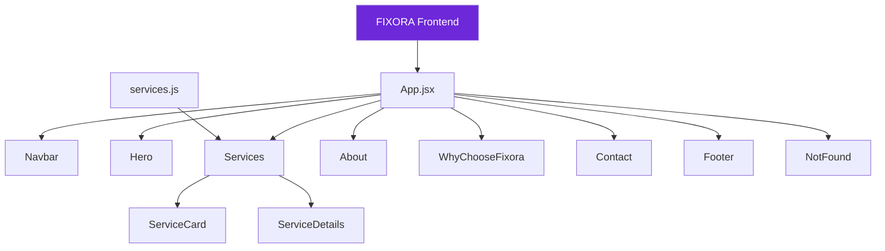
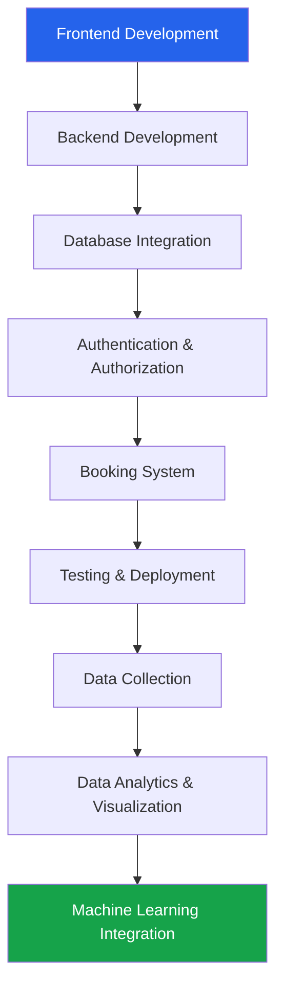

# Chapter 01 – Project Overview

> **Project:** FIXORA – Smart Local Service Marketplace  
> **Tagline:** Find. Book. Fix.  
> **Category:** Full-Stack Web Application  
> **Documentation Status:** Initial Draft

---

## 1.1 Introduction

FIXORA is a Smart Local Service Marketplace designed to connect customers with local service professionals through a centralized digital platform.

Finding reliable professionals for everyday household maintenance and repair services can be difficult. Customers often depend on personal recommendations, local contacts, or unorganized service listings.

FIXORA aims to simplify this process by providing an organized platform where customers can explore services, discover relevant professionals, and eventually manage their service bookings digitally.

The platform focuses on making local service discovery more accessible, convenient, and transparent.

## 1.2 Project Vision

The vision of FIXORA is to build a reliable digital ecosystem connecting customers with trusted local service professionals.

The long-term goal is to develop a scalable marketplace that supports:

- Location-based service discovery.
- Professional service listings.
- Online appointment booking.
- Transparent pricing and service information.
- Customer reviews and ratings.
- Service-provider management.
- Data-driven recommendations and insights.

## 1.3 Problem Statement

Customers frequently face difficulties when searching for local household service professionals.

### Major Problems

1. Difficulty finding suitable professionals.
2. Lack of organized service information.
3. Limited information about professional reliability.
4. Manual coordination for appointments.
5. Limited digital visibility for local service providers.

FIXORA aims to address these problems through a centralized service marketplace.

## 1.4 Proposed Solution

FIXORA proposes a digital platform where customers can explore household services and connect with relevant local professionals.

The proposed solution includes:

- A categorized service catalog.
- Search-based service discovery.
- Dedicated service information pages.
- Customer and professional accounts.
- Appointment booking and management.
- A structured service-provider ecosystem.

Booking, accounts and provider-management capabilities are planned features until their implementation is verified.

## 1.5 Platform Overview

The following diagram illustrates the overall product ecosystem.

*Note: This represents the intended product ecosystem, not the verified current functionality.*

## 1.6 Target Users

### A. Customers

Individuals and households looking for local maintenance, repair and home services.

Their expected requirements include:

- Exploring available services.
- Finding suitable professionals.
- Viewing service information.
- Comparing available options.
- Booking and managing appointments.

### B. Service Professionals

Individuals or businesses offering household maintenance and repair services.

Their expected requirements include:

- Creating professional profiles.
- Listing available services.
- Managing service requests.
- Updating availability.
- Managing customer interactions.

## 1.7 Core Service Categories

FIXORA focuses on everyday household maintenance and repair requirements.

| Service | Description |
|---|---|
| Electrical | Electrical repairs and installations |
| Plumbing | Pipe and water-related repairs |
| AC Services | AC maintenance and repair |
| Carpentry | Furniture repair and woodwork |
| Cleaning | Home and deep cleaning |
| Painting | Residential painting |
| Appliance Repair | Household appliance repairs |
| Pest Control | Pest management |
| Water Purifier | RO and purifier maintenance |

## 1.8 Customer Service Discovery Workflow

The following diagram illustrates the intended customer journey.

*The booking and confirmation steps represent planned functionality.*

## 1.9 Current Frontend Architecture

The currently shared project structure shows a React application organized into reusable components.

This is an initial structural representation. Actual component imports and rendering relationships will be verified through source-code inspection.

## 1.10 Technology Stack

FIXORA follows the MERN stack development direction.

| Technology | Purpose |
|---|---|
| MongoDB | Database |
| Express.js | Backend framework |
| React.js | Frontend library |
| Node.js | Backend runtime |
| JavaScript | Programming language |
| Vite | Frontend development and build tool |

React and Vite are confirmed by the shared frontend project structure. The remaining technologies represent the planned full-stack direction until verified.

## 1.11 Project Objectives

The main objectives are:

1. Develop a user-friendly local service marketplace.
2. Implement organized service discovery.
3. Build reusable and maintainable frontend components.
4. Develop scalable backend services.
5. Integrate database management.
6. Implement secure user authentication.
7. Introduce booking and service management.
8. Apply testing and deployment practices.
9. Integrate data analytics and machine learning in later development phases.

## 1.12 Future Scope

FIXORA is intended to evolve beyond a basic service discovery platform.

Potential future enhancements include:

- Location-based recommendations.
- Online payments.
- Professional verification.
- Customer reviews and ratings.
- Real-time booking updates.
- Admin dashboard.
- Analytics and visualization.
- Machine learning-based service recommendations.
- Predictive service-demand analysis.

## 1.13 Project Development Direction

The project will follow a phased development approach:

## 1.14 Conclusion

FIXORA aims to simplify the process of discovering and accessing local household services through a centralized digital marketplace.

The project provides a practical opportunity to apply full-stack development, software engineering, database management, system architecture, testing, deployment and data science concepts.

Its long-term vision is to create a scalable and intelligent platform that benefits both customers and local service professionals.

---

**Chapter:** 01 – Project Overview  
**Status:** Initial Draft – Pending Source-Code Verification  
**Next Chapter:** Problem Statement and Existing System Analysis