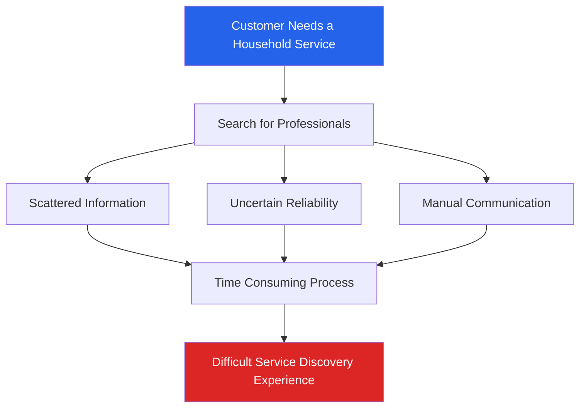
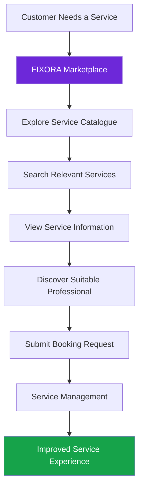

# 01 – Problem Statement

## 1.1 Introduction

Local household services are an essential part of everyday life. People regularly require professionals for electrical repairs, plumbing, air conditioning maintenance, carpentry, cleaning and other household tasks.

However, finding suitable and reliable service professionals can be inconvenient, particularly when customers do not have trusted personal recommendations.

Traditional service discovery often depends on local contacts, word-of-mouth recommendations, phone calls and scattered online listings.

These methods can make the process time-consuming and difficult to manage.

FIXORA aims to address these challenges by developing a centralized digital marketplace for local household services.

## 1.2 Existing System

Customers commonly discover local service professionals through the following methods:

1. Personal recommendations from friends and relatives.
2. Local advertisements and shop contacts.
3. Direct phone calls to service professionals.
4. Social media groups and online listings.
5. General online searches.

Although these methods can help customers find professionals, they may not provide a consistent and organized service discovery experience.

## 1.3 Problems in the Existing System

### 1. Difficulty in Finding Suitable Professionals

Customers may spend considerable time searching for professionals who provide the required service in their area.

### 2. Lack of Centralized Information

Service details, professional information and pricing may be scattered across different sources.

### 3. Trust and Reliability Concerns

Customers may have limited information to evaluate a professional's experience, reputation and service quality.

### 4. Manual Booking and Coordination

Customers often need to contact professionals individually to discuss requirements, availability and appointment timings.

### 5. Limited Digital Visibility

Independent local service professionals may not have access to organized digital platforms for showcasing their services.

### 6. Lack of Organized Service Management

Managing customer requests, appointments and service history manually can become difficult as the number of customers increases.

## 1.4 Problem Analysis Diagram

The following diagram summarizes the major problems faced during traditional local service discovery.

## 1.5 Proposed Problem-Solving Approach

FIXORA proposes a centralized marketplace that organizes service discovery and creates a foundation for structured interactions between customers and local service professionals.

The proposed approach includes:

| Existing Challenge | Proposed FIXORA Approach |
|---|---|
| Scattered service information | Centralized service catalogue |
| Difficult service discovery | Search and categorized services |
| Limited professional information | Dedicated professional profiles |
| Manual booking coordination | Structured booking workflow |
| Limited service management | Customer and provider dashboards |
| Lack of organized feedback | Customer reviews and ratings |

These approaches describe the intended product capabilities. Their implementation will be tracked in the relevant development phases.

## 1.6 Proposed Solution Diagram

*The complete booking and service-management workflow is planned for later development phases.*

## 1.7 Project Motivation

The motivation behind FIXORA is to apply software engineering concepts to a practical problem that affects everyday households and local businesses.

The project aims to:

- Improve the accessibility of local services.
- Create a structured digital marketplace.
- Support local service professionals.
- Simplify service discovery.
- Build a scalable full-stack application.
- Introduce data-driven improvements in the future.

## 1.8 Expected Outcomes

The expected outcomes of FIXORA include:

1. A centralized platform for discovering local services.
2. An organized catalogue of household services.
3. A convenient customer-facing interface.
4. A foundation for professional-service management.
5. A structured booking and appointment workflow.
6. A scalable technical foundation for future enhancements.

## 1.9 Conclusion

The existing methods of discovering local household services can involve fragmented information, manual coordination and uncertainty about service professionals.

FIXORA proposes a centralized digital marketplace to address these challenges through organized service discovery and a structured customer experience.

The project will progressively introduce professional management, booking, administration and intelligent data-driven capabilities.

---

**Phase:** 00 – Project Foundation & Planning

**Document:** 01 – Problem Statement

**Status:** Initial Draft – Pending Review

**Next Document:** 02 – Project Objectives