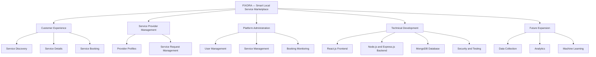

# Project Objectives

## 1. Introduction

The primary objective of **FIXORA** is to develop a Smart Local Service Marketplace that simplifies the process of discovering, selecting, and booking local home services through a centralized digital platform.

The project aims to provide customers with a structured service discovery and booking experience while establishing a scalable foundation for service providers and platform administrators.

**Project Tagline:** Find. Book. Fix.

## 2. Primary Objective

To design and develop a user-friendly, reliable, and scalable MERN-based marketplace that connects customers with local service providers and makes home-service discovery and booking more organized and accessible.

## 3. Specific Objectives

### 3.1 Customer Experience Objectives

- Provide an intuitive and responsive user interface.
- Allow customers to explore available service categories.
- Enable customers to search for relevant services.
- Display detailed information about individual services.
- Provide a structured service booking experience.
- Reduce the effort required to find and request local services.

### 3.2 Service Provider Objectives

- Establish a dedicated module for service providers.
- Provide a foundation for managing provider profiles.
- Support the future assignment and management of service requests.
- Create a structured workflow for customer-provider interactions.

*Note: These capabilities are planned objectives and should not be considered implemented until their corresponding development tasks are completed.*

### 3.3 Platform Administration Objectives

- Establish an administrative module for platform management.
- Provide a foundation for managing customers and service providers.
- Support service catalogue management.
- Enable structured monitoring of booking activities.
- Maintain better control over marketplace operations.

### 3.4 Technical Objectives

- Build the frontend using React.js.
- Develop backend services using Node.js and Express.js.
- Use MongoDB for data storage and Mongoose for database modelling.
- Implement RESTful APIs for communication between frontend and backend.
- Introduce authentication and authorization mechanisms.
- Follow modular and maintainable code organization.
- Apply appropriate validation and error-handling practices.
- Prepare the application for testing and production deployment.

### 3.5 Future Expansion Objectives

After completing the core marketplace, FIXORA may be extended with data-driven capabilities.

Planned areas of exploration include:

- Collecting and organizing marketplace data.
- Analysing customer booking patterns.
- Building analytical dashboards.
- Exploring machine learning applications.
- Identifying useful insights from service and booking data.
- Improving marketplace decisions through data analysis.

These enhancements belong to the future expansion stage and are not part of the current core implementation.

## 4. Project Objective Hierarchy

The following diagram represents how FIXORA's objectives are organized.

## 5. Development Objectives by Roadmap Phase

| Phase | Development Area | Objective |
|---|---|---|
| Phase 00 | Project Foundation | Define the problem, objectives, scope, and development roadmap. |
| Phase 01 | Frontend Development | Build the customer-facing interface and booking experience. |
| Phase 02 | Backend Foundation | Establish the server and backend architecture. |
| Phase 03 | Database Architecture | Design structured database models and relationships. |
| Phase 04 | Authentication & Authorization | Establish secure user access and role-based permissions. |
| Phase 05 | Service Catalogue & APIs | Develop service management functionality and APIs. |
| Phase 06 | Booking Management | Implement the booking lifecycle and related operations. |
| Phase 07 | Service Provider Module | Develop provider-side functionality. |
| Phase 08 | Customer Dashboard | Provide customers with access to their account and booking information. |
| Phase 09 | Admin Dashboard | Establish administrative management capabilities. |
| Phase 10 | Notifications & Payments | Introduce communication and payment-related workflows. |
| Phase 11 | Testing & Security | Validate functionality, reliability, and security. |
| Phase 12 | Deployment & Production Readiness | Prepare and deploy the application for production use. |
| Phase 13 | Analytics & Future Expansion | Explore data analytics and additional intelligent capabilities. |

## 6. Expected Long-Term Outcomes

The long-term vision of FIXORA is to establish a structured local service marketplace that can evolve beyond a basic service listing website.

Expected outcomes include:

1. A centralized platform for discovering local services.
2. A structured customer booking workflow.
3. Dedicated experiences for customers, service providers, and administrators.
4. A maintainable and scalable MERN application.
5. A foundation for future analytics and intelligent features.
6. A practical real-world software engineering project.

## 7. Objective Completion Criteria

Project objectives will be considered achieved progressively as the corresponding roadmap phases are implemented, tested, and documented.

Completion should be evaluated using:

- Functional correctness.
- User experience and responsiveness.
- Code maintainability.
- Data consistency.
- Security and validation.
- Integration reliability.
- Testing results.
- Deployment readiness.

## 8. Conclusion

FIXORA aims to combine service discovery, customer booking, provider management, and administrative capabilities into one organized marketplace.

The development will follow a phased approach, beginning with the frontend and progressing toward backend integration, database design, authentication, marketplace operations, testing, and deployment.

Future analytics and machine learning capabilities will be explored after the core MERN marketplace is established.

---

**Document Status:** Initial Draft — Pending Review

**Next Document:** `03-Scope-and-Requirements.md`